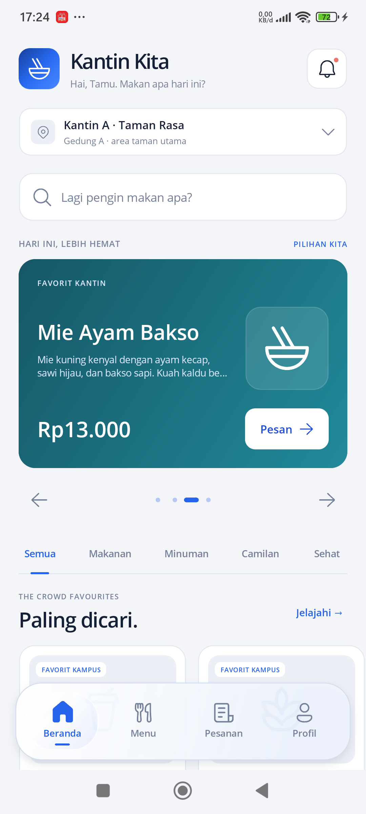
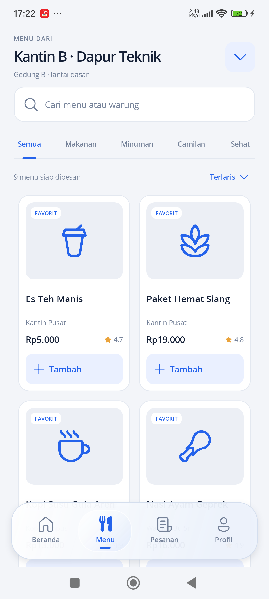
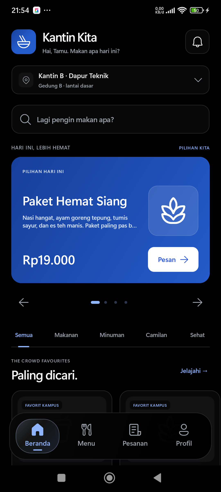
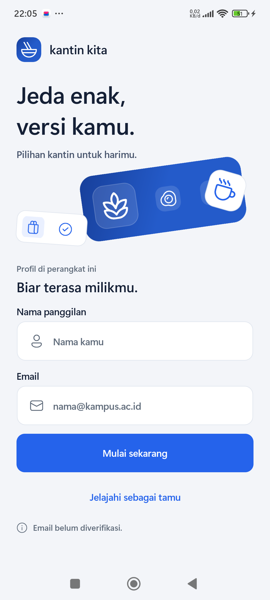
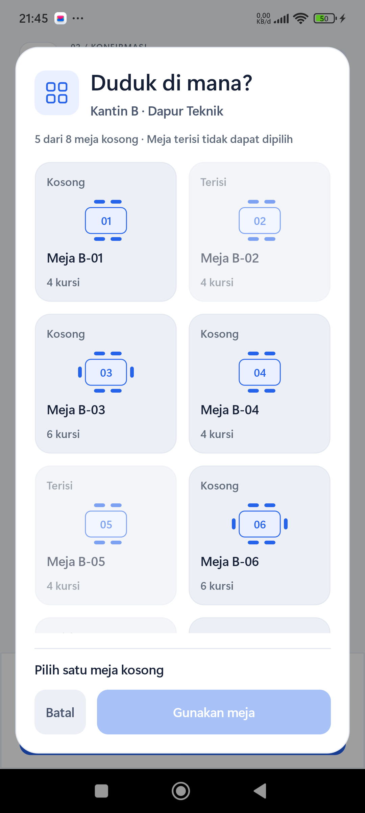
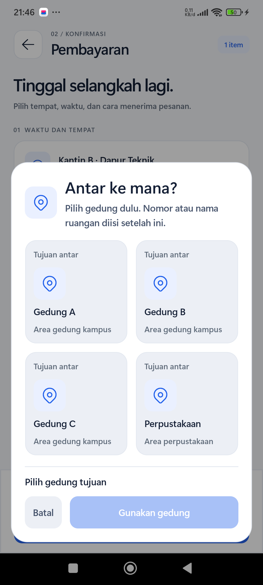
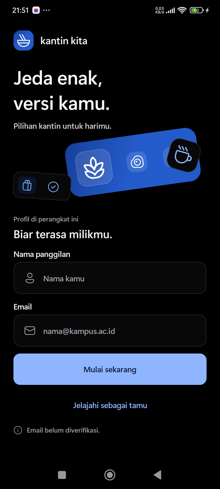
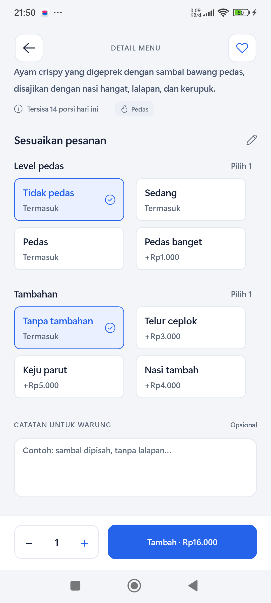
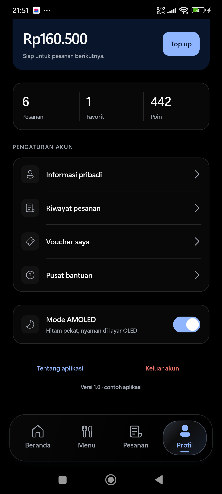

# Kantin Kita

Contoh aplikasi **kantin kampus** untuk Android, dibangun dengan **.NET 10 + .NET MAUI**.
Fokusnya: UI yang rapi dan terasa "produk jadi", arsitektur MVVM yang bersih, dan
praktik .NET 10 tanpa API/komponen warisan.

Desain **Fluent mobile** menggunakan aksen cobalt, surface netral, dan tema AMOLED.
Navbar melayang di atas konten dengan panel kaca berwarna lembut agar tetap terbaca.
Indikator aktif memakai lensa dengan kilau dan gerak lentur, ikon spring, serta fade
180ms untuk perpindahan tab setingkat melalui animator native Android. Ini merupakan efek bergaya kaca ringan,
tanpa blur atau refraksi backdrop.

Seluruh ikon UI, makanan, dan kategori memakai SVG resmi
[Microsoft Fluent System Icons](https://github.com/microsoft/fluentui-system-icons).
Subset beserta lisensi dan manifest sumber ada di `ThirdParty/FluentSystemIcons`.

<p align="center">
  
  
  
</p>

[Lihat swipe promo terbaru tanpa efek zoom](docs/previews/promo-motion.mp4).
[Hasil pengukuran dan pemeriksaan UI](docs/ui-validation.md).
[Keputusan UI dan rujukan resmi Microsoft Fluent 2](docs/fluent2-design-review.md).
[Konfigurasi build dan optimasi .NET 10](docs/build-performance.md).
[Transaksi tersimpan dan ekspor struk](docs/order-receipts.md).
[Profil lokal dan titik integrasi backend](docs/local-profile.md).
[Pengelompokan file di Visual Studio](docs/project-organization.md).
[Katalog per kantin](docs/canteen-catalog.md).
[Meja dan tujuan pengantaran](docs/fulfillment.md).

<p align="center">
  
  
  
</p>

## Fitur

- **Login** — profil lokal nama/email dengan validasi inline, sesi tersimpan, opsi
  tamu, dan keluar akun. `ISignInProvider` dapat diganti layanan backend asli.
- **Kantin** — Taman Rasa (17 menu), Dapur Teknik (9), dan Sudut Pustaka (8).
  Pilihan kantin menyaring Beranda/Menu; hidangan yang sama dapat punya harga dan
  opsi tersendiri. Keranjang dari kantin lain hanya diganti setelah konfirmasi.
- **Beranda** — sapaan personal, pencarian langsung (live filter), selector kategori
  dengan panel pilihan yang dapat digulir, serta satu bagian hasil menu. Tampilan
  awal menampilkan promo dan pratinjau enam menu dengan tombol jelajah katalog.
  Pencarian atau kategori tertentu menampilkan semua hasil yang cocok dan
  menyembunyikan promo. Enter menutup keyboard lalu menggulir ke hasil pencarian.
  Popup notifikasi memakai status baca tersimpan.
- **Menu** — pencarian, selector kategori dan urutan (terlaris / termurah / rating),
  kartu horizontal dengan nama/warung/rating serta area harga dan aksi Tambah
  tersendiri, badge jumlah item, dan empty state. Enter menutup keyboard tanpa
  menggulir halaman. Selector menjaga filter tetap ringkas ketika kategori bertambah.
- **Detail menu** — hero per item, rating & estimasi waktu, sisa stok, opsi varian
  (level pedas, porsi, topping, suhu) dengan harga yang dihitung ulang otomatis,
  catatan untuk warung, dan tombol favorit. Pilihan varian tampil sebagai tile ringkas
  yang memisahkan nama, biaya, dan penanda pilihan.
- **Keranjang** — ubah jumlah, *swipe to delete*, ringkasan biaya, dan **persistensi
  keranjang** ke disk dengan `System.Text.Json` *source generator*.
- **Pembayaran** — pilihan waktu pengambilan, metode pembayaran (Saldo Kantin, QRIS,
  tunai), voucher dengan validasi minimal belanja dan batas diskon, catatan pesanan,
  serta ringkasan pembayaran. Pilih ambil sendiri, makan di meja kosong, atau antar
  ke gedung/ruangan. Picker meja menampilkan kapasitas, status kosong/terisi, dan
  diagram kursi; pilihan meja atau gedung diterapkan setelah konfirmasi.
  Ketersediaan meja berlabel simulasi dan memperhitungkan pesanan lokal aktif.
- **Pesanan** — transaksi tersimpan, status sesuai data pesanan, riwayat, dan "Pesan lagi".
  Struk rinci menampilkan harga, opsi, catatan, diskon, layanan dan total aktual;
  hasilnya dapat dibagikan sebagai PDF dengan halaman lanjutan untuk pesanan panjang.
  Total, metadata pembayaran, dan tombol struk memakai baris terpisah agar teks
  panjang tidak saling menimpa.
- **Profil** — kartu mahasiswa, saldo + top up, statistik, menu akun, dan
  **mode AMOLED** yang tersimpan.
- **Tema** — terang/AMOLED dengan kanvas hitam `#000000`, termasuk status bar dan
  navigation bar Android; surface dinaikkan sedikit untuk menjaga hierarki.
- **Interaksi** — dialog/sort panel milik aplikasi, toggle tema custom, staggered
  reveal, spring pada tombol, feedback angka/favorit, dan promo dengan tilt,
  parallax serta perpindahan dua kartu berukuran tetap, tanpa zoom saat promosi. Mengikuti pengaturan
  animasi Android dan membatalkan gerak saat komponen dilepas.

## Arsitektur

```
KantinKita.csproj            # net10.0-android, UseMaui, SingleProject, XAML SourceGen
App.xaml(.cs)                # theme awal, create window, system chrome
MauiProgram.cs               # DI container + kustomisasi handler Android
Controls/                    # Icon (vector), NavTabItem (bottom nav kustom), Icons (path set)
Converters/                  # InvertedBoolConverter
Data/SeedData.cs             # katalog menu, varian, voucher
Helpers/                     # Money (Rupiah), BrushFactory, Haptics
Models/                      # CanteenMenuItem, CartItem, Order, Voucher, StudentProfile
Services/                    # Menu, Cart (+JSON storage), Order, Voucher, Profile,
                             # Favorite, AppNavigator, Dialog, Settings, SystemChrome
ViewModels/                  # CommunityToolkit.Mvvm (source generators)
Views/
  MainTabsPage               # host 4 tab tersimpan + dock keranjang + native navigation motion
  Tabs/                      # HomeView, MenuView, OrdersView, ProfileView
  ItemDetailPage             # detail menu (sheet + sticky action bar)
  CartPage / CheckoutPage    # keranjang & pembayaran
  ReceiptPage               # struk transaksi tersimpan + berbagi PDF native Android
  OrderSuccessPage           # struk + langkah selanjutnya
Resources/Styles/            # design tokens (warna, tipografi, komponen)
```

Prinsip yang dipakai:

- **MVVM** dengan `ObservableObject`, `[ObservableProperty]`, `[RelayCommand]`.
- **DI** lewat `MauiProgram`; halaman dan view model tidak di-*new* manual.
- **Navigasi** abstrak lewat `IAppNavigator` (view model tidak menyentuh `Page`).
- **Data layer** lewat interface (`ICartService`, `IOrderService`, ...) sehingga mudah
  diganti API sungguhan.
- **Item view model** (`MenuItemCardViewModel`) membungkus item + command + state
  keranjang supaya XAML bebas dari trik `x:Reference`.

## Praktik .NET 10 / MAUI yang dipakai

- `net10.0-android` + `UseMaui` + `SingleProject` (tanpa proyek platform terpisah).
- **XAML Source Generator** (`MauiXamlInflator=SourceGen`) — XAML dikompilasi saat build.
- **Compiled bindings** dengan `x:DataType` di setiap halaman/template.
- `Application.CreateWindow` — bukan `MainPage` yang sudah usang.
- Kontrol modern: `Border` (bukan `Frame`), `CollectionView` (bukan `ListView`),
  `Grid`, `FlexLayout`, `SafeAreaEdges`.
- `System.Text.Json` **source generation** untuk persistensi keranjang (aman untuk trim).
- Android 15+ *edge-to-edge*: background window disamakan dengan kanvas dan warna ikon
  system bar diatur dari `Platforms/Android/SystemUi.cs`.
- Handler Android dikustomisasi di `MauiProgram` (Entry/Editor tanpa garis bawaan).
- Font memakai `sans-serif`/`sans-serif-medium` native Android (Roboto pada Android
  standar; font OEM dapat berbeda), sesuai panduan tipografi Fluent 2 untuk platform.
- Nullable reference types, collection expressions, `required`/`init`, dan
  `JsonSerializerContext` — tanpa `dynamic`, tanpa `Application.Current.MainPage`.

## Menjalankan

Prasyarat:

- .NET SDK 10
- Workload `maui-android` (`dotnet workload install maui-android`)
- Android SDK + emulator/perangkat (API 24+)
- JDK 21 (mis. Microsoft OpenJDK yang ikut Visual Studio)

```powershell
dotnet build -t:Run -f net10.0-android
```

Atau buka `KantinKita.slnx` di Visual Studio, pilih target Android, lalu **Run**.

Package id: `com.kantinkita.app` · Versi demo `1.0`.

Tes regresi gesture promo bisa dijalankan tanpa emulator atau paket test tambahan:

```powershell
dotnet run --project Tests/KantinKita.Gestures.Tests.csproj
```

Regresi binding harga sebelum item siap, perubahan harga varian, cache ikon,
serta pembaruan jumlah keranjang tanpa membuat ulang baris
menggunakan MAUI Controls asli dengan target netral, tanpa emulator:

```powershell
dotnet run --project Tests/ViewModels/KantinKita.ViewModels.Tests.csproj
```

Untuk menilai kelancaran di perangkat fisik, gunakan konfigurasi Release. Debug
proyek ini memakai interpreter untuk debugging dan Hot Reload, sehingga waktu
rendernya berbeda:

```powershell
dotnet build -c Release -t:Run -f net10.0-android -p:RuntimeIdentifier=android-arm64
```

Di perangkat, periksa juga geseran pendek (kartu kembali), geseran panjang yang
ditahan (hanya berpindah sekali setelah dilepas), geseran kanan/kiri, scroll
vertikal lalu swipe lagi (jalur pembatalan dari ScrollView), serta pindah tab
ketika kartu sedang bergerak. Build Debug mencatat hasil sentuhan pada tag logcat
`KantinKita.Promo` dan stack NullReferenceException pada `KantinKita.Exception`.

## Catatan data demo

- Semua menu dan voucher ada di `Data/SeedData.cs` — tidak perlu backend.
- Keranjang disimpan di `FileSystem.AppDataDirectory/kantin-cart.json`.
- Saldo, poin, favorit, dan preferensi tema disimpan lewat `Preferences`.
- Riwayat transaksi disimpan di `kantin-orders.json`; tidak ada pesanan contoh yang
  otomatis dibuat atau status dapur yang berubah hanya karena waktu berlalu.
  Lihat [alur pesanan dan struk](docs/order-receipts.md).

Tes notifikasi dan transaksi/struk:

```powershell
dotnet run --project Tests/Notifications/KantinKita.Notifications.Tests.csproj
dotnet run --project Tests/Orders/KantinKita.Orders.Tests.csproj
dotnet run --project Tests/Session/KantinKita.Session.Tests.csproj
dotnet run --project Tests/Catalog/KantinKita.Catalog.Tests.csproj
dotnet run --project Tests/Choices/KantinKita.Choices.Tests.csproj
```

Seluruh tujuh proyek di atas mencakup 73 pemeriksaan regresi. Lihat
[catatan QA](docs/ui-validation.md) untuk cakupan dan batas pemeriksaan perangkat.

## Login, varian, dan tema AMOLED

<p align="center">
  
  
  
</p>

> Proyek ini semula berupa template Android native (`Activity` + layout XML) dan telah
> dikonversi menjadi aplikasi .NET MAUI 10 sesuai permintaan.


